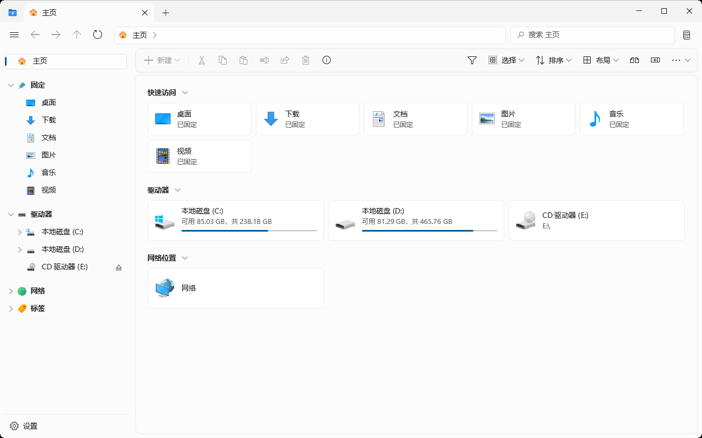
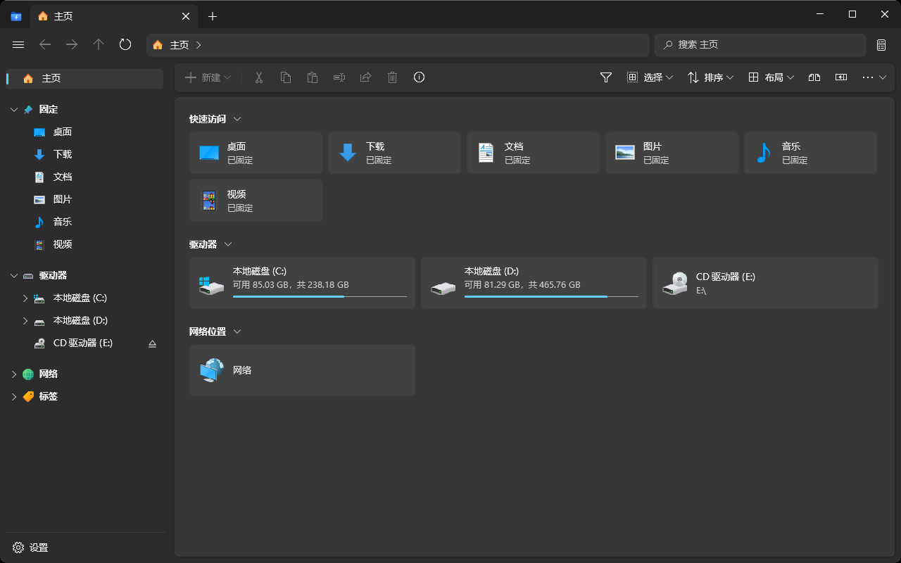
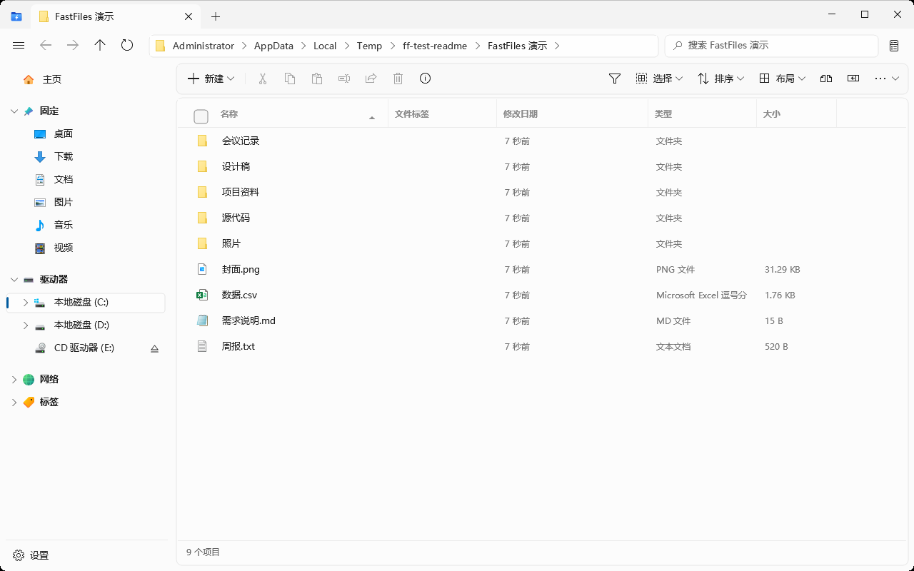
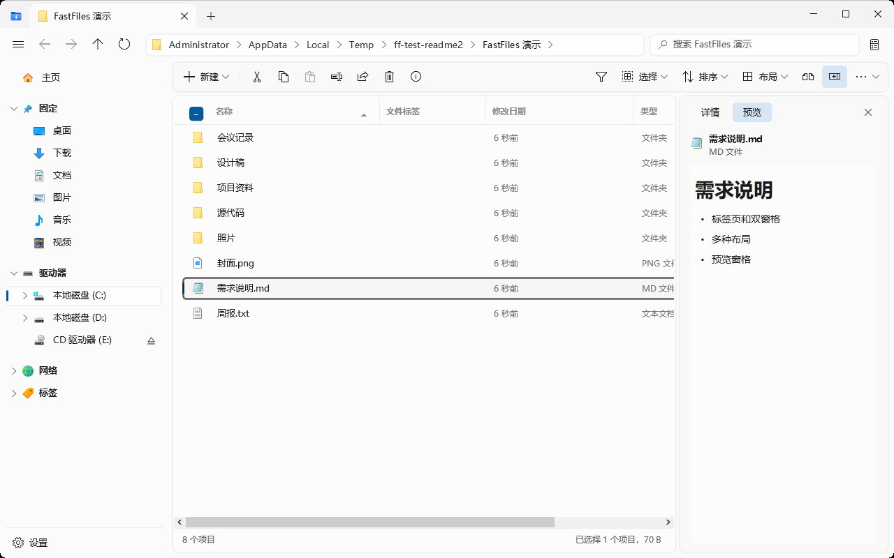
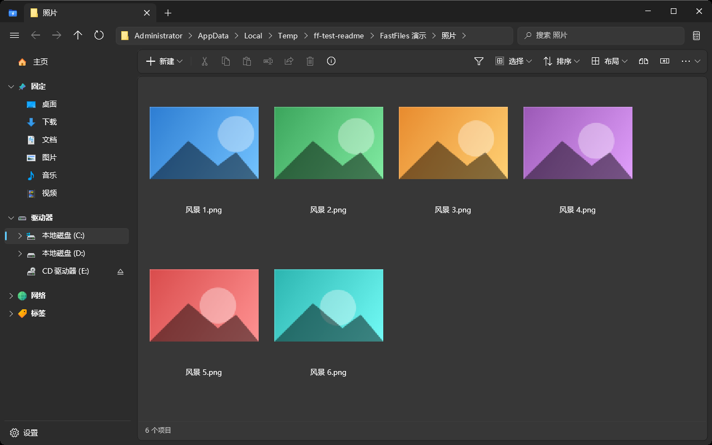
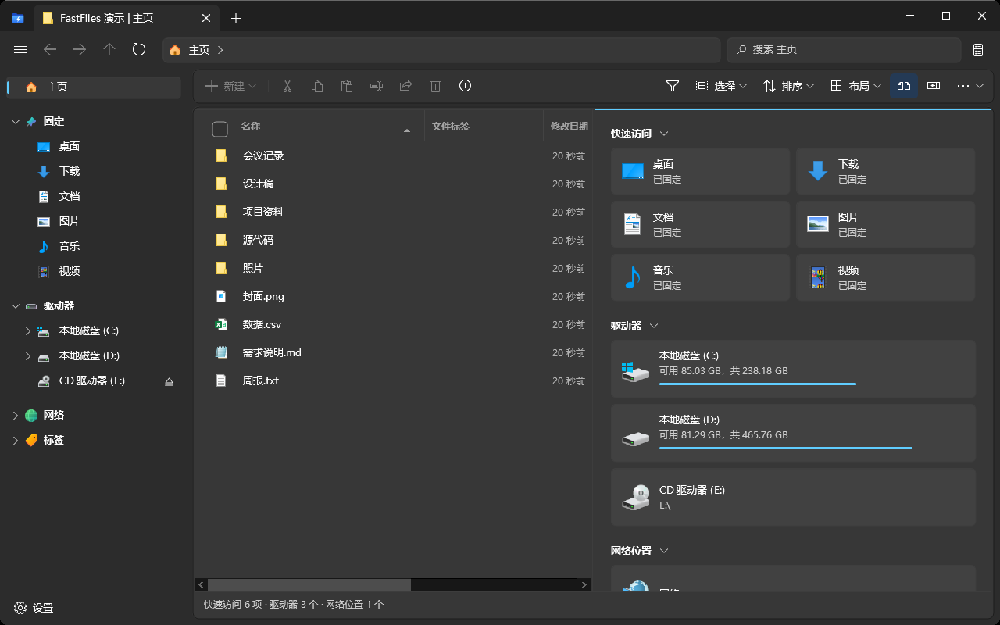
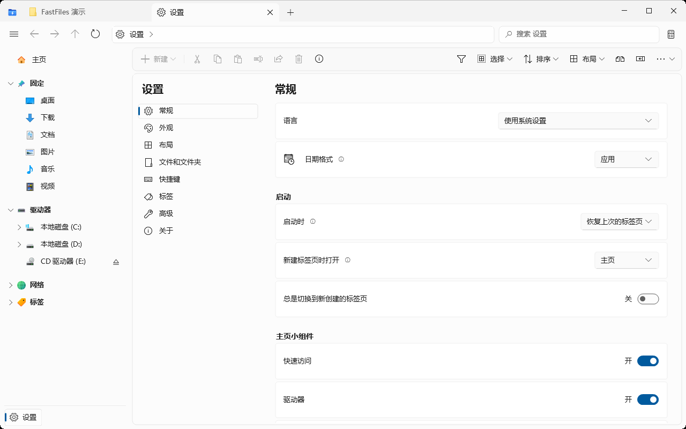

# FastFiles

 [更新日志](CHANGELOG.md)

**快速、轻巧的 Windows 原生文件管理器。** 现代化的界面，标签页、双窗格、多种布局、预览窗格一应俱全，用 C++（Win32）和 Rust 编写，不依赖 .NET 和 WinUI，打开就能用。

## 亮点

- **秒开**：在测试电脑上，从启动到窗口出现约 0.2 秒。
- **省内存**：打开主页时私有内存约 7 MB，工作集约 37 MB。
- **体积小**：程序只有一个 3.4 MB 的 exe，安装包 1.7 MB。
- **单文件便携版**：不用安装，下载 `FastFiles.exe` 直接运行，设置保存在 exe 旁边的 `data` 文件夹里，可以放在 U 盘随身带。
- **兼容性好**：支持 Windows 8、8.1、10、11（64 位），不需要额外安装运行库。
- **在线更新**：在“设置 > 关于”里检查更新，发现新版本后一键下载安装，完成后自动重新打开；安装版和便携版都能更新。
- **不乱改系统**：开机启动、设为默认文件管理器都是设置里的开关，默认关闭；卸载时会把这些设置一并还原。

## 功能

### 浏览

- **标签页**：一个窗口打开多个文件夹；标签可以拖动排序、复制、移到新窗口，误关的标签可以重新打开。
- **双窗格**：左右或上下分屏，两个位置之间拖放、复制、移动文件。
- **主页**：固定的文件夹、驱动器、网络位置集中在一页，一眼找到常用位置。
- **侧边栏**：固定项、驱动器、库、网络、WSL、文件标签，分组可以折叠。
- **地址栏**：面包屑路径，点击任意一级直接跳转，也可以直接输入路径。

### 布局

- **六种布局**：详细信息、列表、卡片、网格、列视图，以及按文件夹内容自动选择的自适应布局。
- **按文件夹记忆**：每个文件夹分别记住布局、排序和分组方式。
- **缩放**：图标和缩略图大小可以随时放大、缩小。

### 预览

- **预览窗格**：图片、文本、Markdown、富文本、音频和视频直接预览；已安装预览程序的文档（如 Office、PDF）也能预览。
- **详情窗格**：显示文件类型、大小、修改日期等详细信息。

### 查找和整理

- **搜索**：按文件名搜索当前文件夹及子文件夹，多个关键词同时匹配，支持 `*.pdf` 这样的通配符，结果边找边显示。
- **文件标签**：给文件和文件夹加上彩色标签，在侧边栏按标签查看。
- **筛选和分组**：按名称筛选当前文件夹，按类型、日期等分组显示。

### 文件操作

- **状态中心**：复制、移动、删除的进度和结果集中显示，可以随时取消。
- **贴心处理**：权限不足时可以用管理员身份重试，文件被占用时提示重试。
- **常用命令**：新建文件和文件夹、用所选项目创建文件夹、复制路径、粘贴为快捷方式、在终端（或管理员终端）中打开、用记事本编辑、用 PowerShell 运行。
- **共享**：通过 Windows 共享窗口把文件发送给附近的设备、邮件或其他应用；选中文件夹时，工具栏和右键的“共享”打开系统的“网络访问”窗口，在局域网中共享给指定用户。
- **刷新**：刷新时列表重新加载，标签页上显示加载动画，一眼就能看到。
- **回收站**：还原选中的项目或全部还原。
- **命令面板**：输入命令名称快速执行任何操作。

### Git

- 在 Git 仓库里显示当前分支和同步状态，可以初始化仓库、克隆仓库。

### 个性化

- **主题**：浅色、深色或跟随系统；Windows 11 上支持云母材质。
- **背景**：自定义背景颜色和背景图片。
- **字体和工具栏**：调整字体，自定义工具栏按钮。
- **快捷键**：每个命令的快捷键都可以自定义。
- **设置导入导出**：换电脑时一键迁移设置。
- **48 种界面语言**。

## 截图

**深色主题**

**详细信息布局**

**预览窗格**

**网格布局**

**双窗格**

**设置**

## 下载

当前版本：**1.0.0.10**（[更新日志](CHANGELOG.md)）

在 [Releases](https://github.com/Ydd535365042/fastfiles/releases/latest) 页面下载：

- `FastFiles_1.0.0.10_x64_Setup.exe`：安装版，创建开始菜单快捷方式（桌面快捷方式可选），支持卸载。
- `FastFiles.exe`：单文件便携版，下载即用。
- `FastFiles_1.0.0.10_x86_Setup.exe` / `FastFiles_x86.exe`：32 位 Windows 用的安装版 / 单文件便携版。

已经安装的 FastFiles 可以在“设置 → 关于”里点“检查更新”直接升级。
